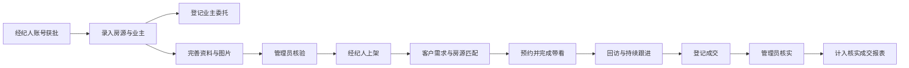
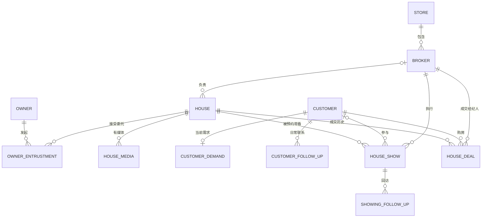

# 二手房管理系统：数据库与业务逻辑说明

> 面向组内前端、数据库、报表和 AI 开发同学。整理日期：2026-10-22。
>
> 本文按当前仓库中的后端实现、建表文件和 V001～V004 迁移脚本整理，说明系统应该怎样使用这些数据。未连接或修改任何实际数据库；各人本机的表结构是否已升级，需要按第 11 节核对。

## 阅读顺序

- **先理解业务**：看第 1～3 节，明确人员、主线和表之间的关系。
- **做页面或接口联调**：看第 4～7 节，了解一次操作会改变哪些数据。
- **写统计 SQL**：看第 8～9 节，统一关联方式和统计口径。
- **不知道该导入哪份 SQL**：看第 11 节，区分全量底稿和增量升级。

---

## 1. 先用一句话理解我们的系统

**管理员管理内部人员、分配业务并审核；经纪人维护业主和房源、跟进客户、安排带看、登记成交；系统保存过程记录，并提供报表与 AI 辅助。**

系统只设两种登录身份：

| 人员 | 负责什么 | 可以看哪些业务数据 |
| --- | --- | --- |
| 管理员 `ADMIN` | 人员申请审核、账号与门店、房源核验与分配、成交核实，也可处理日常业务 | 全局业务，可筛选门店 |
| 经纪人 `BROKER` | 自己的房源、业主、客户、委托、跟进、预约、回访、成交登记和 AI 使用 | **当前门店中，由自己负责的记录** |

业主是“委托我们卖房的人”，客户是“有购房需求的人”。他们都是内部人员维护的业务档案，**不需要在本系统注册登录账号**。门店也不是第三种用户身份。

### 1.1 一笔业务的常见过程



这是推荐的业务组织顺序，并不表示每一步都是下一步的接口硬性前置条件。例如：当前上架检查包含资料、图片、核验和负责人，**没有强制要求房源必须已有委托**；登记成交也不强制要求先存在一条已完成带看。不要把推荐流程理解成代码中尚未实现的限制。

### 1.2 最容易混淆的五件事

| 容易混淆的概念 | 正确理解 |
| --- | --- |
| 登录用户和经纪人 | `sys_user` 管能否登录；`broker` 管业务由谁负责，两者 ID 不能混用 |
| 房源和业主 | `house` 存房子，`owner` 存人，`owner_entrustment` 才记录谁委托我们卖哪套房 |
| 预约和已完成带看 | 共用 `house_show` 表，用 `status` 区分；预约条数不等于实际带看次数 |
| 已登记成交和已核实成交 | 登记后房源会变成 `DEAL`，但管理员核实通过后才进入有效成交业绩 |
| 挂牌价、成交价和 AI 估价 | 分别保存在房源、成交、估价记录中，含义不同，不能互相覆盖 |

---

## 2. 数据库按六组理解，不必一次背下所有表

### 2.1 全部常用表速查

下表列的是当前后端使用的目标结构；某张表在本机看不到时，先检查是否已完成对应升级。

| 分组 | 表名 | 用一句话解释一行记录是什么 |
| --- | --- | --- |
| 人员与登录 | `store` | 一家门店 |
| 人员与登录 | `broker` | 一份经纪人业务档案 |
| 人员与登录 | `sys_user` | 一个内部登录账号或待审核申请 |
| 人员与登录 | `sys_role` | 一种固定身份：管理员或经纪人 |
| 人员与登录 | `sys_user_role` | 一个账号与其身份的关联 |
| 人员与登录 | `auth_session` | 一次业务登录会话 |
| 人员与登录 | `application_session` | 一次仅用于查询、修改申请的临时会话 |
| 房源 | `house` | 一套房源的当前档案 |
| 房源 | `house_media` | 房源的一张图片或一个视频的文件信息 |
| 房源 | `house_status_log` | 房源的一次状态或核验、交接、媒体变更事件 |
| 业主 | `owner` | 一份业主联系档案 |
| 业主 | `owner_entrustment` | 一名业主对一套房源的一次委托参与记录 |
| 业主 | `owner_follow_up` | 一次与业主的联系记录 |
| 业主 | `owner_reminder` | 一条委托到期提醒 |
| 客户 | `customer` | 一份购房客户档案 |
| 客户 | `customer_demand` | 某客户当前的一份购房需求 |
| 客户 | `customer_follow_up` | 一次与客户的日常联系记录 |
| 带看与成交 | `house_show` | 一次预约及其最终带看结果 |
| 带看与成交 | `showing_follow_up` | 一次针对某次带看的回访 |
| 带看与成交 | `house_deal` | 一笔成交登记，包括核实、修改、撤销状态 |
| AI | `house_text_analysis` | 某房源当前缓存的文本分析结果 |
| AI | `house_price_pred` | 一次价格参考结果，允许同一房源有多条历史 |
| AI | `ai_request_log` | 一次 AI 调用及其输入、输出、状态 |
| 追溯与维护 | `operation_log` | 一次重要业务操作的原因和变更摘要 |
| 追溯与维护 | `sys_bootstrap` | 初始化与账号接入流程使用的锁记录 |
| 追溯与维护 | `backend_schema_version` | 数据库脚本的版本标记 |

队员新版底稿中还会看到 `sys_admin`、`sys_oper_log`，以及 `broker` 上的旧登录、审核字段。它们属于历史结构，详见第 10 节。**新业务的统一账号、审核和日志以当前后端使用的表为准。**

### 2.2 表为什么要分开

- **主表放当前情况**：例如房源现在是否在售、客户当前由谁负责。
- **明细表放重复发生的事情**：同一客户可以联系很多次，同一房源可以带看很多次。
- **关系表放人与物之间的约定**：例如谁委托了哪套房、委托多久、是否独家。
- **日志表放过程**：现在显示“已通过”，仍需要知道谁审核的、原来是什么、为什么修改。

因此，“表多”不等于“多了很多模块”。例如用户看到一个业主详情页，后台可能需要读取业主、委托、跟进、提醒四张表。

---

## 3. 表之间到底怎么关联

### 3.1 主业务关系图



说明：图表示业务上的关联，不表示每份历史 SQL 都已建立对应外键。新预约必须关联客户，历史演示带看可能没有 `customer_id`，因此图中保留可空关系。

### 3.2 常用关联字段

| 从哪里找 | 关联到哪里 | 说明 |
| --- | --- | --- |
| `sys_user.store_id` | `store.id` | 账号所属门店；未审核申请可以暂时为空 |
| `sys_user.broker_id` | `broker.id` | 账号对应的经纪人档案；管理员通常为空 |
| `broker.user_id` | `sys_user.id` | 经纪人档案反向指向统一账号 |
| `sys_user_role.user_id / role_id` | `sys_user.id / sys_role.id` | 账号身份 |
| `house.broker_id / store_id` | `broker.id / store.id` | 房源的当前负责人和门店 |
| `owner_entrustment.owner_id / house_id` | `owner.id / house.id` | 业主和房源的委托关系 |
| `owner_reminder.entrustment_id` | `owner_entrustment.id` | 提醒针对哪次委托 |
| `customer_demand.customer_id` | `customer.id` | 客户当前需求；一个客户最多一条 |
| `house_show.house_id / customer_id / broker_id` | 房源、客户、经纪人的 `id` | 看哪套房、谁来看、谁带看 |
| `showing_follow_up.showing_id` | `house_show.id` | 回访针对哪次带看 |
| `house_deal.house_id / customer_id / broker_id` | 房源、客户、经纪人的 `id` | 哪套房卖给谁，由谁成交 |
| `house_media.house_id` | `house.id` | 媒体属于哪套房 |
| `house_text_analysis.house_id` | `house.id` | 一个房源的当前分析缓存 |
| `house_price_pred.house_id` | `house.id` | 房源的历史估价；原始结构允许为空，当前后端从已保存房源发起 |
| `ai_request_log.record_id` | 按调用类型解释 | 当前价格调用成功保存结果时指向 `house_price_pred.id`，不能把所有类型都当成估价关联 |

### 3.3 特别重要：两种“人”的 ID

假设一个账号的 `sys_user.id=12`，绑定的 `broker.id=5`：

- 他的房源负责人是 `house.broker_id=5`。
- 他登记一笔成交时，`house_deal.broker_id` 存业务经纪人 ID；`created_by` 存实际点击登记按钮的账号 ID，二者可能不同。
- `operation_log.actor_id`、`house_status_log.changed_by`、各跟进表的 `created_by`、媒体的 `uploaded_by`，当前代码都按**统一账号 `sys_user.id`**记录操作人。
- 当前 Java 发起 AI 请求时，`requested_by` 也写 `sys_user.id`。旧 SQL 对估价表该字段的“经纪人 ID”注释不能直接套到新业务数据上。
- 管理员可替经纪人录入业务，所以“负责人”和“操作人”本来就可能是两个不同的人。

**查业绩关联 `broker`；查谁操作了系统关联 `sys_user`。不要只看两个编号碰巧相同就认为它们是一回事。**

---

## 4. 各模块的关键字段和业务规则

### 4.1 人员、账号、权限

| 表 | 重点字段 | 业务含义 |
| --- | --- | --- |
| `store` | `name`、`address`、`enabled` | 门店名称、地址、是否可用于新业务 |
| `broker` | `broker_name`、`phone`、`store_id`、`user_id` | 业务人员档案；`dept` 是保留的部门/门店名称文本，关联以 `store_id` 为准 |
| `sys_user` | `username`、`password_hash`、`display_name`、`phone` | 登录名、密码哈希、显示姓名和电话 |
| `sys_user` | `account_status`、`enabled` | 当前账号状态和兼容启用标记；能正常登录需状态为 `ACTIVE` 且启用 |
| `sys_user` | `review_reason`、`reviewed_by`、`reviewed_at`、`version` | 当前审核信息和并发更新版本 |
| `sys_user` | `legacy_source`、`legacy_id` | V004 增加的旧账号来源映射，不是新的登录方式 |
| `sys_role` | `code`、`data_scope`、`permissions` | 当前只使用 `ADMIN / ALL`、`BROKER / OWN` 两种固定身份组合 |
| `auth_session` | `user_id`、`token_hash`、`expires_at`、`revoked` | 普通登录会话；只保存 Token 哈希，不保存原文 |
| `application_session` | `user_id`、`token_hash`、`expires_at`、`revoked` | 申请查询凭证，不能用于操作业务 |

账号申请流程：

```text
提交经纪人申请 → PENDING（待审核）
                  ├─ 管理员通过 → ACTIVE（可登录业务）
                  └─ 管理员拒绝 → REJECTED（可改资料并重提）
                                         └─ 重提 → PENDING

已开通账号：ACTIVE ⇄ DISABLED（管理员停用/恢复）
```

审核通过时，后台分配门店，创建经纪人档案或绑定同店未绑定的原档案，再建立账号与经纪人的双向关联。注册时不能自己指定管理员身份。

补充约定：

- `sys_user_role` 虽然使用关联表，当前业务仍限制**每个账号只有一种身份**。
- 实际权限由 Java 中的 `Permissions` 固定，不能靠直接修改 `sys_role.permissions` 随意扩展身份。
- 有一条 `broker` 数据，不代表这个人已经有可登录的账号。选择新业务负责人时需绑定正常、已审核的经纪人账号。
- 管理员不必绑定经纪人档案。管理员、业主、客户各自不需要再新建一套日常登录模块。
- 停用或调整身份会撤销旧会话；历史业务不随账号停用而删除。

### 4.2 房源：一张主档案，加媒体与历史

| 字段组 | 主要字段 | 说明 |
| --- | --- | --- |
| 位置 | `city`、`district`、`business_area`、`community_name` | 城市、区域、商圈、小区；旧 SQL 的“固定杭州”是原样本说明，当前写入接口没有把城市写死为杭州 |
| 基本属性 | `building_area_sqm`、`internal_area_sqm`、`rooms`、`halls`、`bathrooms` | 建筑/套内面积和室厅卫；未知值用 `NULL`，不要用 0 冒充未知 |
| 房屋属性 | `floor_level`、`total_floors`、`orientation`、`decoration`、`has_elevator`、`property_usage` 等 | 使用约定枚举，不混存中文名称和枚举代码 |
| 展示内容 | `core_selling`、`community_intro`、`surrounding` | 卖点、小区介绍、周边配套，也是文本分析输入来源 |
| 价格和日期 | `listing_price_yuan`、`listing_date` | 当前挂牌总价（元）、挂牌日期 |
| 业务控制 | `status`、`verification_status`、`store_id`、`broker_id`、`version`、`deleted` | 生命周期、审核、数据归属、版本与归档 |
| 来源 | `source`、`data_origin`、`source_listing_id` | 录入渠道、导入/业务来源、原平台编号；这几个字段不是房源主键 |

`community_id` 是保留字段，当前仓库没有单独的小区主表，不要按名字猜测出不存在的表。经纬度要成对填写；套内面积不能大于建筑面积。

房源有**两组独立状态**：

| 字段 | 值 | 含义 |
| --- | --- | --- |
| `status` | `OFF` | 下架、未对外销售 |
| `status` | `ON_SALE` | 在售 |
| `status` | `DEAL` | 已由成交登记占用，不能普通上下架或改资料 |
| `verification_status` | `PENDING` | 等待管理员核验 |
| `verification_status` | `VERIFIED` | 核验通过 |
| `verification_status` | `REJECTED` | 核验驳回，需要更正资料后重提 |

实际流转：

1. 新录入：`OFF + PENDING`。
2. 完善资料与媒体，管理员审核：通过后为 `OFF + VERIFIED`，**审核不会自动上架**。
3. 经纪人上架：变为 `ON_SALE + VERIFIED`。需要有效门店和经纪人、正挂牌价、区域/小区/面积/室厅卫信息，以及至少一张有效图片。
4. 修改房源资料：审核回到 `PENDING`；原本在售的房源自动下架。
5. 上传/删除媒体、换封面、排序：房源变为 `OFF + PENDING`，版本递增。图片换序也需要重新审核。
6. 有待执行预约时，普通手动下架会被阻止；资料或媒体修改造成的自动下架会保留原预约，后续需重新核验上架，或由人员处理预约。
7. `DEAL` 只能由成交流程进入，不能直接改状态伪造成交。

媒体说明：`house_media` 存文件名、类型、大小、上传人、封面和顺序，**文件内容在上传目录中**。数据库导出文件不会自动包含图片/视频文件；复制数据库后还需要对应文件目录，才能正常显示媒体。

历史说明：`house_status_log` 记录房源事件，即使 `from_status=to_status`，也可能发生了核验、负责人调整等重要操作。

### 4.3 业主和委托：用中间表记录“谁委托哪套房”

`owner` 保存姓名、电话、地址、备注、负责人和最新联系计划。

`owner_entrustment` 重点字段：

| 字段 | 含义 |
| --- | --- |
| `owner_id / house_id` | 业主和被委托房源 |
| `start_date / end_date` | 委托起止日期，结束日期不能早于开始日期，新建时不能已经到期 |
| `is_exclusive` | 是否独家；接口参数名为 `exclusive` |
| `commission_rate` | 约定佣金比例，0～1，例如 2% 填 `0.02` |
| `agreement_id` | 将共同委托的多位业主参与记录归为同一份协议 |
| `status / end_reason` | 参与记录当前状态与结束原因 |
| `store_id / broker_id` | 这份委托的业务归属，创建时取业主档案归属 |

为什么不在 `house` 里只放一个 `owner_id`：一位业主可委托多套房，一套房也可能有多个共有业主，还要保留多次委托历史。

**共同委托举例：**

```text
第一条：业主甲 → 房源 101，委托记录 601，agreement_id=601
第二条：业主乙 → 房源 101，新增时 jointWithId=601
        保存为另一条参与记录，但 agreement_id 也为 601
```

- `jointWithId` 是新增请求的参数，指向已有的委托记录；数据库主要保存共同的 `agreement_id`，没有单独的协议主表。
- 同一共同委托的房源、日期、独家约定、佣金比例须一致，同一业主不能重复加入冲突的有效委托。
- 结束甲的委托参与，不会同时结束乙的参与。
- 不同协议之间仍检查独家冲突与同一业主的重叠委托。

委托状态：`ACTIVE` 有效、`EXPIRED` 已到期、`CANCELLED` 人工结束、`COMPLETED` 因房源成交完成。注意人工“结束委托”保存为 `CANCELLED`，不是 `ENDED`。

`owner_reminder` 每份委托最多一条提醒，`due_date` 为委托到期日，`read_status=UNREAD/READ` 表示有没有读。定时任务默认每天 09:00 检查到期及未来 7 天内到期的委托，新建临期委托也会立即检查提醒。

**委托是否到期看委托状态和日期；提醒是否已读看 `read_status`。两者不是同一个状态。**

### 4.4 客户和需求：档案、当前要求、历史沟通分开

| 表 | 保存什么 | 更新方式 |
| --- | --- | --- |
| `customer` | 姓名、电话、标签、备注、归属、状态、最新联系计划 | 修改当前档案 |
| `customer_demand` | 区域、预算、面积、室数、装修、预计购买日期、说明 | 一个客户最多一条，设置需求会新增或覆盖当前需求 |
| `customer_follow_up` | 渠道、联系内容、下次联系时间、操作人、时间 | 每次沟通新增一行，保留历史 |

客户状态：

- `ACTIVE`：正在跟进，可以新增预约。
- `INACTIVE`：暂不跟进，保留 `inactive_reason`；有待执行预约时需先处理预约。
- `DEAL`：已登记成交，由成交模块维护，不能通过普通客户状态接口直接设置。

客户房源匹配按已填需求筛选**当前权限范围内的在售房源**；未填条件不限制。它是查询结果，不会再存一张“匹配结果表”。

特别提醒：需求中的 `decoration` 不填才表示不限。传 `UNKNOWN` 在当前匹配代码中会筛选装修值为 `UNKNOWN` 的房源，不能把它当成“不限装修”。

### 4.5 三种跟进，不要写到同一张表

| 业务 | 明细表 | 主记录上的最新计划 |
| --- | --- | --- |
| 联系业主 | `owner_follow_up` | `owner.next_contact_at` |
| 日常联系客户 | `customer_follow_up` | `customer.next_contact_at` |
| 某次带看后的回访 | `showing_follow_up` | `house_show.next_contact_at` |

业主/客户跟进的渠道使用 `PHONE / VISIT / WECHAT / OTHER`。新增跟进会保留明细，同时覆盖主档案的最新联系计划；本次不填下次联系时间，就清除旧计划，并不是继续沿用上一条时间。

带看回访还保存意向 `HIGH / MEDIUM / LOW / UNKNOWN`。`house_show.feedback`、`intention` 为最近一次反馈摘要；多次回访的完整历史在 `showing_follow_up`。

### 4.6 带看：一条预约逐步完成，不再另建“实际带看表”

| 字段 | 含义 |
| --- | --- |
| `house_id / customer_id / broker_id` | 看哪套房、哪位客户、由谁带看 |
| `appointment_time` | 预约时间 |
| `completed_time` | 实际完成时间，预约未完成时为空 |
| `show_time` | 兼容查询字段：预约时写预约时间，完成后改成实际完成时间 |
| `customer_name` | 创建时保存的客户姓名快照/旧演示字段，不替代 `customer_id` |
| `status` | `SCHEDULED / COMPLETED / CANCELLED` |
| `cancel_reason` | 取消原因 |
| `follow_up_time` | 最近一次填写回访的时间，不是下一次联系时间 |
| `next_contact_at` | 下一次应联系客户的时间 |
| `data_origin` | 区分新业务 `BUSINESS` 与旧演示 `LEGACY_DEMO` |

预约时要求房源在售、客户正在跟进、关联记录同门店、执行经纪人正常。后台检查该经纪人前后 30 分钟内是否已有待执行预约，避免时间冲突。

```text
新增预约：SCHEDULED
          ├─ 改期：仍为 SCHEDULED，修改预约时间
          ├─ 完成：COMPLETED，写入 completed_time
          └─ 取消：CANCELLED，保留原因

COMPLETED 后可多次新增 showing_follow_up 回访。
```

管理员只能交接待执行预约，不能修改已完成带看的历史执行人。统计实际带看时使用 `completed_time`，不要把还在预约阶段的 `show_time` 当作已完成时间。

### 4.7 成交：交易有效性和核实状态分开

`house_deal` 存一笔交易的房源、客户、经纪人、门店、成交日期、实际金额、佣金和审核信息。

| 字段 | 取值/含义 |
| --- | --- |
| `status` | `CONFIRMED` 表示登记仍有效；`CANCELLED` 表示已撤销 |
| `verification_status` | `PENDING` 待核实、`APPROVED` 通过、`REJECTED` 拒绝 |
| `verified` | 当前是否已核实通过，和核实状态同步维护 |
| `transaction_price_yuan` | 实际成交总价，单位元 |
| `commission_yuan` | 实际佣金，单位元，不是百分比 |
| `deal_time` | 成交发生日期时间；不是创建记录时间 |
| `verified_by / verified_at / verify_reason` | 最近核实人、核实时间、意见 |
| `cancel_reason` | 撤销原因，原记录继续保存 |

一套房源可以保留多笔先后撤销、重新登记的历史，但同时只允许一笔未归档的 `CONFIRMED` 成交；该限制由后端事务和房源锁保护。

登记时即使还未核实，也会进入下面的联动；所以不能仅凭 `house.status=DEAL` 认定这笔成交已经核实。

---

## 5. 一次操作会改哪些表

### 5.1 登记成交是最重要的一组联动

以下动作由后端放在同一事务里处理：

| 顺序 | 表 | 改变 |
| --- | --- | --- |
| 1 | `house_deal` | 新增：`CONFIRMED + PENDING + verified=false` |
| 2 | `house` | `ON_SALE → DEAL`，更新状态时间、版本 |
| 3 | `customer` | 状态变为 `DEAL`，版本递增 |
| 4 | `house_show` | 该房源尚未执行的预约变为 `CANCELLED`，原因是房源已成交 |
| 5 | `owner_entrustment` | 该房源所有有效委托变为 `COMPLETED` |
| 6 | `house_status_log / operation_log` | 保存房源成交事件与成交登记操作 |

当前自动取消的条件是**该房源**的待执行预约，并不等于同时取消该客户在其他房源上的所有预约。

管理员核实通过后：`verification_status=APPROVED`、`verified=true`，此时才进入核实成交业绩。

管理员驳回后：这笔登记仍是 `CONFIRMED`，房源和客户仍保持成交占用状态。经纪人需要更正未核实成交，再回到 `PENDING`；或按业务实际撤销。**驳回不是撤销。**

### 5.2 撤销成交

| 对象 | 处理 |
| --- | --- |
| 成交记录 | `status=CANCELLED`，`verified=false`，保存撤销原因，保留历史核实状态供追溯 |
| 房源 | 变为 `OFF`，不会自动恢复上架 |
| 客户 | 如果已没有其他有效 `CONFIRMED` 成交，则恢复 `ACTIVE` |
| 已取消预约 | 不自动恢复，需重新安排 |
| 已完成委托 | 不自动恢复，需按新情况登记委托 |
| 日志 | 追加撤销事件，历史成交记录仍在 |

未核实的有效成交可以更正；已核实成交不能普通编辑。已核实成交的撤销需要管理员处理。

### 5.3 分配与交接

- 房源交接修改房源的负责人/门店，并保存原、新归属。它不会自动把相关客户、业主和所有历史业务一起改到新负责人名下。
- 房源跨店交接受到关联业务限制；当前存在未归档委托、带看或成交等关联记录时，会阻止跨店交接。
- 业主交接会同步其有效委托的经纪人；历史跟进和已结束委托保留历史。
- 客户、业主普通资料修改不能直接变更负责人，需走管理员交接入口。
- 只交接预约时，还需安排关联房源、客户的权限归属。经纪人能看见一条预约，不代表自动能看见其他人负责的房源、客户。
- 换门店或停用员工前要处理未完结业务；已完成带看和已核实成交保留原经纪人、原门店，避免把历史业绩改写。

### 5.4 归档与重复档案

| 对象 | 当前归档前置条件 |
| --- | --- |
| 房源 | 已下架，没有有效委托，没有待执行预约 |
| 业主 | 没有有效委托 |
| 客户 | 没有待执行预约，也没有有效 `CONFIRMED` 成交，包含尚未核实的成交 |

归档后主记录仍保存在库中，日常列表通过 `deleted=0` 隐藏它，相关历史不应被一起物理删除。媒体删除也是逻辑删除；磁盘文件保留，文件清理需要单独安排。

同电话业主或客户会提供可见范围内的重复提示，不自动合并、不设成所有门店共用的同一个人。电话号码可能重复或变更，关联业务仍使用档案 ID；需要合并档案时应另行设计迁移流程，不能直接把某条记录删掉。

---

## 6. 用一个例子把整套库串起来

以下都是说明用的编号和金额，不代表数据库中的实际记录。

| 步骤 | 业务动作 | 数据变化 |
| --- | --- | --- |
| 1 | 门店 1 的经纪人小林开通账号 | `sys_user.id=12` 绑定 `broker.id=5` |
| 2 | 小林录入房源 101，挂牌价 200 万 | `house.id=101`，`broker_id=5`，`listing_price_yuan=2000000`，状态 `OFF/PENDING` |
| 3 | 登记业主 201、委托 601 | `owner_entrustment` 关联 `owner_id=201`、`house_id=101` |
| 4 | 上传图片，管理员核验，小林上架 | `house_media` 新增；房源最终为 `ON_SALE/VERIFIED` |
| 5 | 登记客户 301，预算 180～210 万 | `customer` 新增；`customer_demand` 保存 `min_price=1800000`、`max_price=2100000` |
| 6 | 客户匹配到房源 101 | 查询返回匹配说明，没有新增交易记录 |
| 7 | 预约带看 401，完成后回访 | `house_show` 从 `SCHEDULED` 到 `COMPLETED`；`showing_follow_up` 新增反馈 |
| 8 | 以 195 万成交，佣金 3.9 万 | `house_deal.transaction_price_yuan=1950000`、`commission_yuan=39000`；执行第 5 节的成交联动 |
| 9 | 管理员核实 | 成交变为 `APPROVED/verified=true`，可计业绩 |

这时同一套房可能同时有：

- 房源挂牌价 **200 万**；
- 真实成交价 **195 万**；
- 某次 AI 历史参考价 **198 万**。

三个数字同时存在是合理的，它们回答不同的问题。委托中的 `commission_rate=0.02` 也不代替成交记录中的实际佣金 `39000`。

---

## 7. AI、待办和日志为什么单独保存

### 7.1 AI 三张表各管一件事

| 表 | 作用 | 特点 |
| --- | --- | --- |
| `house_text_analysis` | 页面当前要展示的摘要、优势、不足、词频 | 同一房源最多一条当前缓存，重新分析会更新它 |
| `house_price_pred` | 历次价格参考结果 | 同一房源可有多条，保存模型版本、数据版本、输入快照、参考区间 |
| `ai_request_log` | 调用过程追踪 | 保存文本/价格调用、输入输出、发起账号、当时房源版本与失败原因 |

需要认识的字段与状态：

- `request_id`：一次调用的追踪编号，用于将日志和结果对起来。
- `input_snapshot / result_snapshot`：调用当时的输入/输出，避免以后房源变了就解释不清旧结果。
- `input_hash / feature_hash`：识别当前输入是否已变化。
- `house_version`：调用时的房源业务版本，位于请求日志中；它不等于模型版本。
- 文本缓存常见状态是 `PENDING / SUCCESS / FAILED`；异步文本结果若已落后于最新输入，请求日志可标记 `STALE`，避免旧结果覆盖新资料。
- 价格服务返回 `DEMO_ONLY` 表示历史样本参考，`UNAVAILABLE` 表示当前不能估价；调用异常记入日志 `FAILED`，不保证会新增一条估价结果。
- `stale` 是后端根据当前特征与旧结果的哈希比较后返回的标志，**不是要求每张表都新建一个 `stale` 数据列**。
- `UNAVAILABLE` 时价格和区间可以是 `NULL`，不能用 0 元表示“估价成功”。

保存房源后，文本分析在主事务提交后触发；Python 服务失败不应把已经保存的房源回滚。价格参考由用户主动发起，不会覆盖挂牌价或成交价。

### 7.2 待办大部分是查出来的

目前没有单独的通用 `task` 表。工作台根据已有业务字段查询：

| 待办 | 数据依据 |
| --- | --- |
| 待审核注册 | `sys_user.account_status=PENDING` |
| 今日/逾期联系业主 | `owner.next_contact_at` |
| 今日/逾期联系客户 | `customer.next_contact_at`，且客户仍 `ACTIVE` |
| 今日/逾期带看 | `house_show.status=SCHEDULED` 和预约时间 |
| 带看尚未回访 | 已完成的新业务带看，且不存在对应 `showing_follow_up` |
| 回访后需要再联系 | `house_show.next_contact_at`，且带看已完成 |
| 待核验房源 | `house.status=OFF` 且核验状态 `PENDING` |
| 待核实成交 | `house_deal.status=CONFIRMED` 且核实状态 `PENDING` |

今日联系人和逾期联系人可分开统计；今日待带看与已经逾期但仍在今天的预约可能重叠，不能直接相加当去重人数。

### 7.3 两张当前日志表的分工

- `house_status_log`：专门用于房源时间线，含原状态、新状态、事件、原因、账号、时间。
- `operation_log`：跨模块审计，含 `resource_type`、`resource_id`、`event_type`、`actor_id`、`reason`、变更前后摘要。

`resource_type=user/house/owner/customer/showing/deal` 决定 `resource_id` 应去哪张业务表查。例如 `resource_type=deal` 时关联 `house_deal.id`，不能把所有日志的 `resource_id` 都当成房源 ID。

日志用于保存关键变更，**不表示每次读取、每个普通编辑都一定有一条统一操作日志**。跟进明细、本次审核字段、房源事件和通用日志需要按问题分别查看。

---

## 8. 报表同学必须统一的口径

### 8.1 先确定你到底在数什么

| 指标 | 正确来源/条件 |
| --- | --- |
| 在售房源数 | `house.deleted=0 AND status='ON_SALE'` |
| 全部房源库存档案数 | 未归档的房源，可能包括下架、在售、已成交；不要和“在售数”混用 |
| 实际带看次数 | `house_show.deleted=0 AND status='COMPLETED' AND data_origin='BUSINESS'` |
| 核实成交笔数/金额 | `house_deal.deleted=0 AND status='CONFIRMED' AND verified=1 AND verification_status='APPROVED'` |
| 挂牌均价 | 从 `house.listing_price_yuan` 算；它不是实际成交均价 |
| 实际成交均价 | 从满足上面条件的 `house_deal.transaction_price_yuan` 算 |
| 经纪人成交业绩归属 | `house_deal.broker_id`，不要用 `house` 当前负责人代替历史成交人 |
| 历史带看业绩归属 | `house_show.broker_id`，不是当前房源经纪人 |
| AI 使用次数 | `ai_request_log`，并按状态区分成功、失败、不可估价等 |

### 8.2 三类日期

| 查询对象 | 日期条件 |
| --- | --- |
| 房源库存/价格 | 挂牌日期 `listing_date` |
| 实际带看 | 完成时间 `completed_time`；当前完成流程同时更新兼容字段 `show_time` |
| 成交 | 实际成交时间 `deal_time` |
| AI 使用 | 请求日志创建时间 `created_at` |

“2026-10-01 到 2026-10-31”的日期筛选应包含 10 月 31 日全天。日期时间通常用 `>= 开始日期 AND < 结束日期次日`，避免只统计到结束日 00:00。

`create_time / created_at` 表示录入数据库的时间，不能代替挂牌时间、实际带看时间或成交时间。Java 业务日期口径按 `Asia/Shanghai` 约定使用。

### 8.3 权限必须先过滤，再汇总

经纪人范围的基本条件是：

```sql
-- :storeId 和 :brokerId 必须取自已登录身份，不能直接相信页面提交的值。
WHERE deleted = 0
  AND store_id = :storeId
  AND broker_id = :brokerId
```

这里的 `:参数` 是说明用占位符，Java/MyBatis 实际使用参数绑定。管理员可以查全局，经纪人不能通过修改 URL 的门店或经纪人编号查看他人数据。明细、详情、匹配、报表、导出应保持相同范围。

### 8.4 避免统计结果翻倍

一套房有 3 次带看和 2 张图片，直接把房源、带看、图片连在一起会得到 6 行。此时 `COUNT(*)` 不是 1 套房，也不是 3 次带看。

做门店业绩时，先分别汇总房源、带看、成交，再按门店关联汇总结果。做去重房源数时明确使用 `COUNT(DISTINCT house_id)`。平均价格也要先保证每套房或每笔交易只出现一次。

### 8.5 已有扩展图表的特殊含义

- “转化漏斗”显示在售房源、发生过实际带看的房源、已核实成交房源的快照计数，不是同一批对象严格递减的漏斗。
- 经纪人 `conversionRate` 为核实成交笔数 ÷ 实际带看次数 × 100%；分母为 0 返回 `NULL`，这个比值不表示客户成交概率，也可能超过 100%。
- `house-age-distribution` 当前以可见样本最大挂牌日作为观察日计算库龄，不是距今天的天数，图表标题需说明。
- 操作审计用 `operation_log`；兼容返回里的 `operatorType` 可能为 `NULL`，不根据操作人的当前身份推断当时身份。

---

## 9. 可以直接照着理解的查询示例

以下均为只读查询，针对完成兼容后的目标结构；示例编号需要替换。没有在你的数据库上执行。第 9.1～9.4 节展示关联关系，若用于经纪人页面，还需按第 8.3 节加入当前身份的业务范围条件。

### 9.1 查房源的当前负责人和门店

```sql
SELECT h.id, h.community_name, h.status, h.verification_status,
       h.listing_price_yuan, b.broker_name, s.name AS store_name
FROM house h
LEFT JOIN broker b ON b.id = h.broker_id
LEFT JOIN store s ON s.id = h.store_id
WHERE h.deleted = 0 AND h.id = 101;
```

### 9.2 查一套房有哪些业主委托

```sql
SELECT e.id AS entrustment_id, e.agreement_id,
       o.id AS owner_id, o.name AS owner_name,
       e.start_date, e.end_date, e.status,
       e.is_exclusive, e.commission_rate
FROM owner_entrustment e
JOIN owner o ON o.id = e.owner_id
WHERE e.house_id = 101 AND e.deleted = 0
ORDER BY e.id DESC;
```

保留历史时不要随意排除已归档主档案，否则可能把已有委托关系隐藏。日常可选业主列表和历史关系查询用途不同。

### 9.3 查客户的当前需求和历次带看

```sql
-- 当前需求：最多一条。
SELECT * FROM customer_demand WHERE customer_id = 301;

-- 历次预约/带看：可能很多条，不能只按客户姓名关联。
SELECT sh.id, h.community_name, sh.appointment_time,
       sh.completed_time, sh.status, b.broker_name
FROM house_show sh
JOIN house h ON h.id = sh.house_id
LEFT JOIN broker b ON b.id = sh.broker_id
WHERE sh.customer_id = 301 AND sh.deleted = 0
ORDER BY sh.id DESC;
```

### 9.4 查成交业绩和实际操作人

```sql
SELECT d.id, d.deal_time, d.transaction_price_yuan,
       d.commission_yuan, d.verification_status,
       b.broker_name AS deal_broker,
       u.display_name AS recorded_by
FROM house_deal d
JOIN broker b ON b.id = d.broker_id
LEFT JOIN sys_user u ON u.id = d.created_by
WHERE d.deleted = 0
  AND d.status = 'CONFIRMED'
  AND d.verified = 1
  AND d.verification_status = 'APPROVED';
```

### 9.5 管理员按门店统计已核实成交

```sql
SELECT s.id, s.name,
       COUNT(d.id) AS deal_count,
       COALESCE(SUM(d.transaction_price_yuan), 0) AS total_price_yuan
FROM store s
LEFT JOIN house_deal d ON d.store_id = s.id
  AND d.deleted = 0
  AND d.status = 'CONFIRMED'
  AND d.verified = 1
  AND d.verification_status = 'APPROVED'
GROUP BY s.id, s.name
ORDER BY total_price_yuan DESC;
```

将成交条件放在 `LEFT JOIN ... ON` 中，可以保留“没有成交的门店”，其数量、金额显示为 0。

---

## 10. 为什么数据库里看起来有“两套账号、两套日志”

这是历史底稿和当前实现并存造成的，不代表现在要做两套系统。

| 旧表/旧字段 | 当前后端如何使用 |
| --- | --- |
| `sys_admin` | 旧管理员账号来源；开启兼容时，校验原账号密码后接入统一账号 |
| `broker.username / password` | 旧经纪人账号来源；仅在统一账号尚不存在时进行凭据核验和接入 |
| `broker.audit_status / reject_reason / account_status` | 接入时将旧状态映射到 `sys_user`；后续审核、启停以统一账号为准 |
| `sys_user` | 当前实际登录、审核、权限关联和会话管理的账号主表 |
| `sys_oper_log` | 旧版管理员日志表，当前业务不会把它当作新的统一日志来源 |
| `operation_log` | 当前跨模块操作日志 |

在当前 `LegacyAccountService` 中，旧账号兼容默认启用，可通过 `app.security.legacy-accounts-enabled` 配置关闭。它的工作方式是：

1. 先查 `sys_user`。
2. 如果统一账号不存在，再检查旧账号并验证用户本次输入的密码。
3. 核验通过后，创建统一账号、绑定身份及原经纪人档案；新密码按 BCrypt 哈希保存。
4. 保存 `legacy_source / legacy_id`，记录从哪条旧账号接入。
5. 后续登录优先使用统一账号；不能用旧表的密码绕过统一账号的新密码或停用状态。

**V004 补结构，不会仅靠执行脚本就批量创建旧账号的统一登录记录；接入发生在凭据校验通过时。** 旧经纪人仍待审或已停用时，接入也不等于获得正常业务登录权限。

旧管理员与旧经纪人登录名冲突、档案已被绑定等情况会阻止接入，需要确认归属，不能擅自合并。

不要在文档或群里传播真实密码，也不要为了“结构统一”直接删除旧表中的记录；这些数据仍可能承担来源追溯和兼容用途。

---

## 11. 几份 SQL 各是什么，应该怎么理解

### 11.1 文件用途

| 文件 | 作用 |
| --- | --- |
| `database/house_system_full.sql` | 早期原始房源/经纪人/带看/价格参考底稿，基础表较少，含导入样本 |
| `database/house_system与后端统一+初始数据录入版.sql` | 队员新版全量底稿，包含更多业务表、旧账号字段和初始数据，但仍与当前后端存在字段差异 |
| `V001__backend_business.sql` | 在早期底稿上补齐账号、门店、业务、媒体、日志等基础结构 |
| `V002__admin_broker_only.sql` | 将旧身份收敛为管理员、经纪人，调整人员绑定及会话 |
| `V003__workflow_completion.sql` | 补账号申请审核、版本、共同委托、联系计划、媒体封面排序、成交审核和统一日志 |
| `V004__team_database_compatibility.sql` | 兼容队员新版底稿或已有 V003 开发库，规范字段名，补流程字段与旧账号来源映射 |

迁移脚本目录：`backend/src/main/resources/db/migration/`。当前配置没有自动执行这些 SQL 的流程，不要因为文件放在 `migration` 文件夹就认为启动时已自动升级。

### 11.2 按现有起点选择路径

| 现有起点 | 对应升级路径 |
| --- | --- |
| 新建空开发库，选择早期底稿 | 早期全量 SQL → V001 → V002 → V003 → V004 |
| 新建空开发库，选择队员新版底稿 | 队员新版全量 SQL → V004；不要再机械执行 V001～V003 的重复加列操作 |
| 已经完成 V001～V003 的业务库 | 保留数据，按版本和结构核对 V004 |
| 不知道当前库来自哪里，或混合改过结构 | 先核对实际表结构和版本，不直接叠加两份全量 SQL |

两份全量文件都包含 `DROP TABLE`，用于从对应底稿重建环境，不能拿来覆盖已有业务库。升级操作应先备份、停止后端，再由负责数据库的同学执行未应用版本。**本文只解释路径，没有执行导入或升级。**

V004 使用条件判断补列，但也包含数据回填；“可按结构判断”不意味着可以在生产业务运行中随意反复执行。MySQL 的结构变更会隐式提交，不能把整个脚本当作一笔可自动回滚的业务事务。

### 11.3 常见字段名对应关系

| 历史底稿 | 当前 Java 使用的数据库列名 | 说明 |
| --- | --- | --- |
| `broker.name` | `broker.broker_name` | V004 在满足条件时改名 |
| `house.created_at` | `house.create_time` | 房源创建时间的规范名 |
| `broker.created_at` | `broker.create_time` | 兼容原业务结构 |
| `house_show.created_at` | `house_show.create_time` | 带看创建时间的规范名 |
| 队员版 `house_show` 缺少 `show_time` | 补 `show_time` | 与已有查询逻辑兼容，和 `completed_time` 不混淆 |
| 队员版 `house_show.completed_time` 非空 | 允许为空 | 尚未完成的预约没有实际完成时间 |
| `sys_user.store_id` 非空 | 允许为空 | 待审核经纪人可能尚未分配门店 |

数据库里其他表仍可能使用 `created_at`，不要把全库所有创建时间字段一律改成 `create_time`。`house` 的更新时间在两份底稿中也有 `update_time / updated_at` 差异，业务统计不要依赖猜测出来的列名。

较早的 README、报表合并说明可能只写到 V003；涉及队员新版底稿与旧账号接入时，需要一并看当前 V004 与 `LegacyAccountService`。

### 11.4 让组员先检查什么

这些是只读检查，不涉及账号密码：

```sql
SELECT DATABASE();
SHOW TABLES;
SELECT version, applied_at FROM backend_schema_version ORDER BY version;
SHOW COLUMNS FROM sys_user;
SHOW COLUMNS FROM broker;
SHOW COLUMNS FROM house_show;
```

重点核对：`sys_user.account_status/version/legacy_source/legacy_id`，`broker.broker_name/store_id/user_id`，`house_show.show_time/appointment_time/completed_time/next_contact_at`，以及 `application_session`、`operation_log` 是否存在。

版本表是脚本执行标记，V004 还会补齐 1～4 的标记，**不能单凭这些数字就认定原 V001～V003 都逐条执行过、所有结构都完全一致**。实际结构与业务约束仍需核对。

---

## 12. 组内开发统一约定

### 12.1 共同字段的含义

| 字段/类型 | 约定 |
| --- | --- |
| `id` | 本表主键；不要拿其他表的 ID 代替 |
| `store_id / broker_id` | 门店与经纪人业务归属；即使可从关联表推导，也会在业务记录上保留，便于权限与历史统计 |
| `created_by / actor_id / changed_by` 等 | 当前代码中的实际登录操作账号，不是默认等于经纪人 |
| `version` | 防止两人覆盖修改的业务版本；更新需携带最近读取的版本，过期会返回 409，刷新后重试 |
| `deleted` | 有此字段的业务表中，0 正常、1 归档；不是把数据库行物理删除 |
| `data_origin` | 区分导入房源、历史演示带看与新业务；不能为了图表好看随意改成 `BUSINESS` |
| `NULL` | 未知或未提供；不自动等于 0、空字符串、未发生 |
| 金额 | 数据库基本单位为元；页面显示万元需除以 10000 |
| 面积 | 平方米；单价单位为元/平方米 |
| JSON 字段 | 朝向、标签、区域列表、快照等保存结构化数据，按数组/对象传递，不拼成任意字符串 |

常见接口命名对应：`broker_id → brokerId`、`listing_price_yuan → listingPriceYuan`。数据库列使用下划线，Java API 多使用 camelCase；AI 输入快照内部可能保留 snake_case。`exclusive` 是委托写入参数，读取数据库返回时则可能为 `isExclusive`。

前端收到的 `id / *Id` 使用字符串，避免 JavaScript 大整数精度丢失；金额、数量、页码仍按对应数值类型处理。不要对所有返回字段无差别执行 `Number()`。

### 12.2 各组员实际怎么分工

| 工作 | 建议做法 |
| --- | --- |
| 前端 | 通过后端接口读写；按钮按当前角色显示；提交修改带版本；后端拒绝流转时展示原因，成功后重新读详情 |
| 数据库 | 维护底稿与增量结构，核对列名、可空性、唯一约束、索引和样本来源；结构变更先与后端同步 |
| 报表 | 从业务表读取，先过滤权限和有效状态再聚合；金额、日期和来源按第 8 节统一 |
| AI | 对接约定输入输出与状态；业务写库、调用记录和结果保存由 Java 当前流程承担，避免同次请求重复落库 |
| 后端 | 负责鉴权、数据归属、状态校验、联动事务、版本冲突与日志，不让页面直接拼 SQL 改多张业务表 |

### 12.3 看不懂数据时，按这个顺序问

1. **这是一行什么记录？** 是当前档案、一次事件、一份关系，还是旧演示样本？
2. **关联谁？** 用业务 ID 找主表，不用姓名、电话当永久关联键。
3. **现在有效吗？** 同时看 `deleted`、业务状态、审核状态，不能只看其中一个。
4. **谁能看？** 确认当前账号门店与经纪人归属，避免把权限过滤误认为数据丢失。
5. **为什么变了？** 看相关跟进明细、房源时间线、成交核实信息、通用日志。
6. **结构来自哪版？** 核对实际列名、可空性和迁移版本，再判断是否是代码问题。

---

## 附录：进一步查哪些文件

本文的业务规则主要依据当前代码；需要调整规则时，应同步实现与说明，而不是仅修改数据库注释。

| 想查什么 | 仓库位置 |
| --- | --- |
| 接口、参数与权限 | [backend/API.md](../backend/API.md) |
| 表格第二、三步如何落实 | [backend/WORKFLOW_IMPLEMENTATION.md](../backend/WORKFLOW_IMPLEMENTATION.md) |
| 报表口径与接口合并 | [backend/TEAM_REPORT_INTEGRATION.md](../backend/TEAM_REPORT_INTEGRATION.md) |
| 数据库结构升级 | [db/migration](../backend/src/main/resources/db/migration/) |
| 两种身份及数据隔离 | `security/Permissions.java`、`security/AccessScope.java`、`common/ResourceAccess.java` |
| 旧账号接入 | `auth/LegacyAccountService.java`、`auth/AuthService.java` |
| 注册、审核与本人资料 | `auth/RegistrationService.java`、`system/SystemService.java` |
| 房源、媒体与状态日志 | `house/HouseService.java`、`house/MediaService.java` |
| 委托与到期任务 | `owner/OwnerService.java`、`owner/OwnerReminderJob.java` |
| 联系计划和待办 | `common/FollowUpService.java`、`common/TaskService.java` |
| 客户、带看、成交 | `customer/CustomerService.java`、`showing/ShowingService.java`、`deal/DealService.java` |
| 报表和 AI 保存 | `report/ReportService.java`、`report/ReportCustomController.java`、`ai/AiService.java` |

上面 Java 路径均相对于 `backend/src/main/java/system/`。
